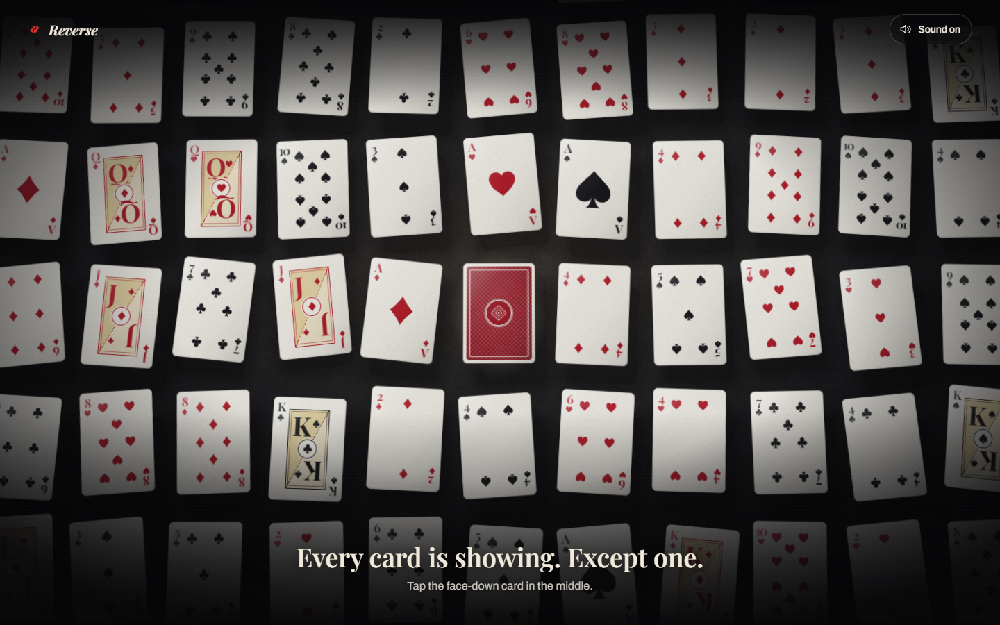

# Reverse

A field of floating playing cards, all face up except one. Flip the odd one out and it turns out it was never a playing card: it's an UNO Reverse, and the whole field turns over.



## Run

```sh
npm install
npm run dev
```

Open http://127.0.0.1:5197. `npm run build` produces a self-contained static website in `dist`; `npm run preview` serves that build on port 4197. `npm test` runs the deck and timing checks.

## Play

- Every card floats face up except the one in the middle, which shows the same classic back as the rest of the deck.
- Click or tap it (or Tab to it and press Enter / Space). It rises, turns over to reveal the reverse, and the field flips face-down in a wave that ripples outward, while a soft shockwave nudges the cards away from the centre.
- Click the reverse again to undo: the wave runs backwards, edges first, and the reverse turns face-down last.
- Move the pointer and the whole field leans toward it, so the cards' different depths read as parallax.
- **Sound on / off** in the top-right. Each card has a fingertip flick, an air whoosh and a soft snap, panned by its position and quieter further from the centre. The reverse gets a swell like a cymbal played backwards.
- Reduced-motion preferences turn off the drift, parallax and shockwave, and flips become instant.

## How it works

Plain DOM and CSS 3D transforms; no WebGL or framework. Every card is its own preserve-3d stack (arrival → shockwave push → idle drift → resting pose → flip lift → flip spin), so each motion is a separate, compositor-friendly transform. Each card drifts on its own slow, randomised cycle at its own depth. A flip alternates between two keyframe sets so the animation restarts reliably, and its delay comes from the card's distance to the centre. Cards left of centre turn leftward and cards on the right turn rightward, so the wave reads as radial.

The field is 13 × 9 cards dealt from three shuffled packs. Identical cards are never placed side by side or one above the other. Desktop shows 13 × 7 and lets the edges bleed off the screen; phones show 7 × 9. The centre card stays centred in both.

All sound is synthesised with Web Audio (filtered noise bursts and short sine thumps, through a compressor), scheduled on the audio clock so it lines up with the CSS timing. Nothing plays until the first click, as browsers require.

### Files

- `src/deck.js` — dealing, pip layouts, visibility per layout and wave timing; pure functions.
- `src/deck.test.js` — deck composition, no adjacent twins, centring, and the outward / inward wave order (`npm test`).
- `src/main.js` — builds the field, runs the flip, sound toggle and pointer parallax.
- `src/audio.js` — the synthesised card sounds.
- `src/style.css` — card faces, the classic back, the reverse face, floating and flip choreography.
- `public/textures/` — the linen card-stock emboss and backdrop grain, generated by `scripts/textures.py` (numpy + Pillow; deterministic).

Fonts are Archivo and Playfair Display, bundled locally from `@fontsource-variable` (SIL Open Font License). No network connection is needed after the page loads.

### Practical limits

About 90 cards animate in 3D at once on desktop. The idle drift and flips only animate transforms, but very low-end devices may still drop frames during the wave. The touch path is a normal click and has not been tried on physical phone hardware.

## Validation

`npm test` passes 9 checks and the production build succeeds. Browser checks covered the 1440 × 900 desktop and 390 × 844 phone layouts (no horizontal overflow; the centre card stays centred), the reveal, the undo, and click hit-testing on the centre card inside the 3D field. Frame rate and audio have not yet been measured.
